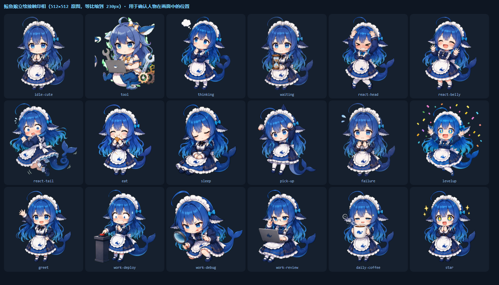
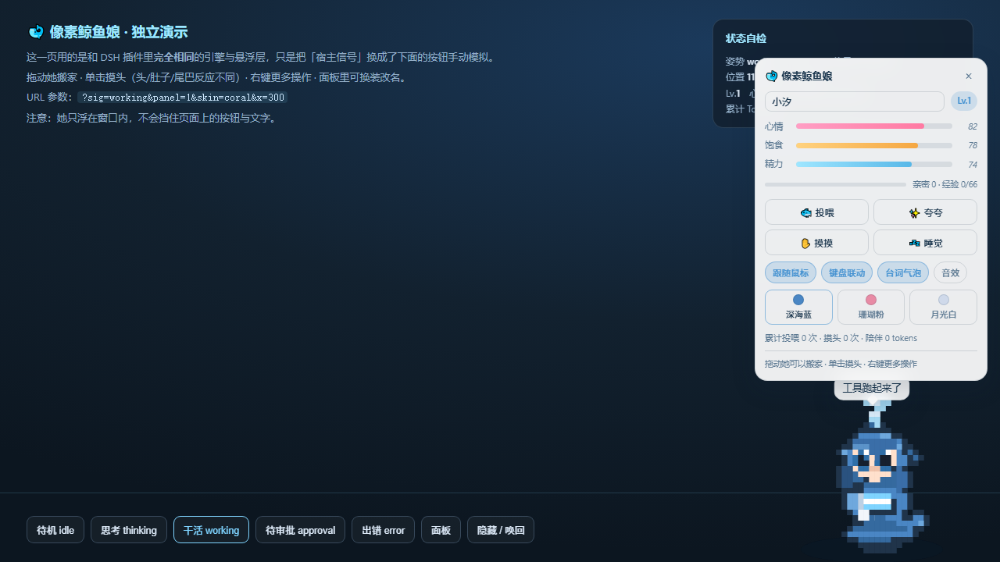

# 🐋 鲸鱼娘 · DeepSeek Harness 桌宠

一只常驻 DSH 界面的鲸鱼娘。她**知道你在干什么**：模型在跑就歪头思考，工具在动就抱起笔记本，
卡在待审批就举着沙漏等你，出错就蔫下来；你摸头、投喂、夸夸她，她按 Token 用量慢慢长大。

**默认只留桌面版**：她是一个**独立的桌面透明置顶窗口**，浮在整张桌面上、盖住所有程序，


DSH 最小化甚至关掉她都还在 → 见[桌面模式](#桌面模式把她放到桌面上独立窗口)。
插件本体仍然装着，但**默认不在 DSH 窗口里画她**——它继续在后台采集"干活/思考/待审批"信号，
转给桌面版用。想让她回到窗口里：DSH 设置 → 桌宠 → 打开「在 DSH 窗口里显示」。

**两种画风，随时切换**（面板或 DSH 设置 → 桌宠）：

| 画风 | 说明 |
|---|---|
| **插画立绘**（默认） | 92 张精致日系立绘，来自 [dsh-whale-musume](https://github.com/Sutera-Diffusus/dsh-whale-musume)（MIT，署名见 [`assets/art/ATTRIBUTION.md`](assets/art/ATTRIBUTION.md)）。干活/思考/待审批/摸头/捏肚子/拽尾巴/睡觉/升级…各有专属立绘 |
| **像素** | 内置手绘像素渲染器，代码画的、**零资源零依赖**；立绘未就绪或加载失败时也会自动回退到它，不会出现空白帧 |

- **零侵入**：不改任何内置包文件，不遮挡业务 UI（整层 `pointer-events:none`）
- **零遥测**：不联网、不外发，养成数据只在本机 `localStorage`
- **真联动**：读宿主公开的结构化标记与会话状态，不是定时随机换图


---

## 参考了哪三个项目

| 项目 | 借鉴的东西 |
|---|---|
| [Sutera-Diffusus/dsh-whale-musume](https://github.com/Sutera-Diffusus/dsh-whale-musume) | 插件形态与工程结构：单包双面（宿主半边注册只读静态路由 + 客户端半边惰性 CJS 注入）、状态机与表现层分离、按工具状态切姿势、工作态姿势钉住、`0.2.0-rc.2` 的 DOM 契约；**以及插画立绘资源**（92 张 webp，MIT） |
| [xiaoshihou514/dsh-desktop-pet](https://github.com/xiaoshihou514/dsh-desktop-pet) | 交互手感：拖拽搬家、松手惯性滑行、撞边抓停、右键菜单 |
| [ChisaAlter/WhaleIsle](https://github.com/ChisaAlter/WhaleIsle) | 养成环：摸头/投喂/夸夸、**按 Token 用量成长**、成长数据本地存档 |

**架构上最重要的一点**：行为内核（状态机 / 会话联动 / 养成 / 物理 / 交互 / 设置）与美术层是分离的，
中间只有一个 `Pet.setArt()` 接口和 `draw(ctx, pet)` 约定。所以：

- 换画风 = 换一个美术层，**行为逻辑一行都不用动**；
- 美术层画不出来（没加载完 / 文件缺失 / 出错）就返回 `false`，内核自动回退像素渲染器；
- 想接你自己的立绘包，只要照着 [`assets/art-musume.js`](assets/art-musume.js) 实现
  `fileFor()` / `draw()` / `zoneAt()` 三个方法即可。

像素引擎、状态机、信号探测、设置面板均为本仓库原创实现。

---

## 她能做什么

### 会话联动（核心）

| 宿主在干什么 | 她的反应 |
|---|---|
| 模型正在生成 | 歪头思考（`think`） |
| 有工具在跑（命令/改文件/搜索…） | 抱起笔记本干活，带屏幕光晕（`work`） |
| 有操作在等你确认 | 举感叹号、放大瞳孔、弹「需要你确认一下～」（`approve`） |
| 工具报错 | 蔫下来、半睁眼、说话变小声（`sad`） |
| 空闲 | 待机、冒水汽、随机自言自语 |
| 工具刚跑完就断信号 | **姿势钉住 8 秒**，不会抽搐 |

### 互动

- **单击摸头**：分三个判定区——**头**（开心，+心情）、**肚子**（会缩一下，-心情）、**尾巴**（甩尾巴，-心情）
- **连点三下**：星星眼庆祝 + 粒子特效
- **拖动**：切换「被拎起来」姿势、四脚乱蹬，松手后按你甩出的速度惯性滑行、撞边抓停
- **右键**：投喂 / 夸夸 / 摸摸 / 睡觉 / 回原位 / 打开面板 / 隐藏
- **键盘联动**：你打字时她跟着抬手敲（可在面板关掉）
- **眼神跟随**：空闲时瞳孔会跟着鼠标转
- **久无操作**：她自己犯困去睡，攒精力

### 养成

心情 / 饱食 / 精力三条数值 + 等级 + 亲密度 + 累计投喂/摸头/Token，全部本地存档；
离线一段时间会饿一点、睡回精力，回来时还会抱怨一句。

---

## 安装

已经装在这台机器上了（当前 `desktop` profile），装的是**链接**依赖，所以改仓库文件即时生效：

```powershell
# 安装 / 更新（改完代码重跑一次即可）
$dsh = "C:\Users\l3561\AppData\Local\Programs\DeepSeek Harness\resources\runtime\cli\bin\dsh.cmd"
& $dsh plugin --profile desktop add "E:\Web\deepseel mena"

# 卸载
& $dsh plugin --profile desktop remove dsh-whale-pixel-pet
```

装完**刷新界面即可看到她**（`Ctrl+F5`）。改了 `assets/*.js` 只刷新页面就生效；
改了 `lib/client.js`（注入接线）建议重启一次桌面端更稳。

> 桌面端的 `desktop` profile 只能由上面这个自带 shim 管理：`dsh/lib/bin.js` 会拒绝
> 其它模式下的 `--profile desktop`。

### 改完代码怎么让它生效

| 改了什么 | 怎么生效 |
|---|---|
| `assets/*.js` / `assets/*.css` / `assets/art/**`（含立绘） | 资源是插件启动时抓取的 → **刷新界面（`Ctrl+F5`）** 即生效 |
| `lib/client.js` / `package.json` / `cordis.patch.yml` | 需要重新物化客户端模块 → 刷新界面；仍不生效就重启桌面端 |
| `lib/index.js`（宿主半边，如新增 MIME） | 跑在主进程里，**需要重启桌面端** |
| profile 的 `cordis.patch.yml` | 由 `dsh-hmr` 热重载（也可以用它主动"逼"一次重载） |

> 实测踩到过：`dsh plugin add` 在依赖没变化时是**空操作**，不会触发重载；
> 只改资源文件也不会自动重载——刷新界面才有效。

### 验证安装成功

界面按 `F12` 打开控制台：

```js
window.__dshWhalePixelPetBooted        // true
document.querySelectorAll('[data-dsh-whale-pet-root]').length   // 1
window.__dshWhalePixelPet.stats()      // { pose, ambient, level, ... }
```

任一项不对，先看控制台有没有 `[dsh-whale-pixel-pet]` 开头的告警。

---

## 桌面模式：把她放到桌面上（独立窗口）

> 下面是**demo 页**的截图（无隐私），不是真实桌面截图——真实桌面截图里有个人内容，已排除在仓库外。



上面那种是"住在 DSH 窗口里"。她还支持另一种形态：**独立的透明置顶小窗口**，
浮在整个桌面上、盖在所有程序之上，DSH 最小化了甚至关掉了，她还在。


### 怎么开

最方便的入口：**DSH 设置 → 桌宠 → 桌面桌宠** 卡片，看状态、一键「启动桌面桌宠」/「退出」/「刷新」。

也可以走命令行（`.cmd` 支持双击，里面带了执行策略绕过）：

```powershell
.\desktop\start-pet.cmd        # 启动
.\desktop\stop-pet.cmd         # 退出
```

或者右键托盘里的 🐋 → 退出桌宠。

### 她在这个形态下的行为

| 能力 | 说明 |
|---|---|
| 置于顶层 | `alwaysOnTop('screen-saver')`，盖住普通窗口，全屏程序上也可见 |
| **鼠标穿透** | 指针不在她身上时整窗穿透，点得到下面的桌面和其它软件；落在她身上才接管。判定由**主进程轮询系统光标位置**完成（不依赖 Electron 的 `forward` 事件转发——那在 Windows 上不可靠） |
| 拖动搬家 | 拖她 = 移动窗口，位置记在 `%APPDATA%\dsh-whale-pet-desktop\position.json`，重启还在原位 |
| 点她 | 单击摸头（头/肚子/尾巴三区，反应立绘各不同） |
| **右键菜单** | 原生菜单：摸摸头 / 夸夸她 / **玩一下** / **散步（走过去）** / **喂点东西 ▸（6 种食物）** / 睡吧 / 换个画风 ▸ / 像素配色 ▸ / 设置面板 / 回到右下角 / 藏起来 / 退出 |
| **散步 = 窗口真的走** | 桌面版的「散步」不是她在窗口里挪，而是**整个窗口沿着屏幕走一段**（150 px/s，走到工作区边界为止）。路上会**随机停一两次**看风景；如果那会儿鼠标在她附近，她会改成跟你打招呼（walkLook / walkMeet 两套台词）。走完自己停下并记住新位置 |
| **她有口味** | 最爱吃的和不太爱吃的**由名字推导**（同名同口味，改名字就换口味），所以不用改存档格式。喂到最爱：心情额外 +10、亲密 +4、撒星星、走 oodFavorite 台词；喂到不爱吃的：心情 −6、小口小口吃。**口味是发现式的**——没喂到过最爱，面板和菜单里就不显示（喂到过会在菜单里标 ★） |
| **设置面板** | 看近况（等级·经验·亲密·心情·饱食·精力·累计 Token·投喂·摸头·姿势），能互动（摸摸头/投喂/夸夸她/玩一下/散步/睡吧）、换画风、换配色、开关音效·气泡·信息栏、改名、重置养成、回右下角、藏起来 |
| 托盘 | 🐋 图标：叫她出来/藏起来、回到右下角、打开 DSH、退出 |
| 会话联动 | 读 DSH 插件写的状态文件，干活/思考/待审批/出错照常换姿势；DSH 没开就自己待机 |
| 独立进程 | 她**不在 DSH 的进程树里**（`detached`），DSH 重启/退出都不会带走她 |
| 不吃键盘 | 这个形态没有键盘联动（没有全局按键钩子），键盘联动只在 DSH 窗口里生效 |

### 她不见了怎么办（自愈机制）

桌宠最忌讳"莫名其妙就没了"，所以加了两道保险：

1. **随 DSH 启动**（默认开）：宿主半边每次加载时按配置把她拉起来，
   即使上一轮她被带走了，DSH 一启动她就回来。开关在设置卡片的「随 DSH 启动」，
   存在 `%LOCALAPPDATA%\dsh-whale-pet\config.json`（`{"autoStart":true}`）。
2. **自己登记 pid**：不管是脚本、快捷方式还是宿主路由启动的，
   应用启动时都会把自己的 pid 写进 `desktop/.pet.pid`，退出时清掉，
   所以设置面板里的状态永远是真的。

> 面板上的「退出」是**立即关掉她**（`taskkill /T`），不会改「随 DSH 启动」这个偏好。
> 如果她突然消失，先看托盘里还有没有 🐋；没有就点「启动桌面桌宠」重开一次。

### 两种宿主，一套交互实现

早先窗口版和桌面版各写了一份交互，结果桌面版"功能不对等"。现在**动作语义只有一份实现**：

```text
assets/pet-actions.js      ← 摸摸头 / 投喂 / 夸夸 / 睡吧 / 配色 / 改名 / 重置 / 近况快照
        ├── 窗口版：whale-pet-overlay.js 的 doAction() 转发过来
        └── 桌面版：desktop/renderer.js 的右键菜单与设置面板转发过来
```

`test/actions.test.mjs`（13 项）直接对这份实现断言：投喂涨多少饱食、摸摸头无视冷却、
睡吧是开关、静音时动作照做但不出声、重置只清养成保留外观……谁改坏了立刻红。

> 这层测试写完当场抓到一个真 bug：面板里的"投喂/摸头"次数读错了字段
> （引擎里叫 `totalFeed` / `totalPat`，我写成了 `fedCount` / `patCount`），会永远显示 0。

### 状态是怎么传过来的

DSH 的 web server 对 `/api` 路由**有鉴权**，外部进程拿不到凭证，所以走文件而不是 HTTP：

```text
DSH 窗口里的客户端半边  --POST-->  插件宿主半边  --写文件-->  %LOCALAPPDATA%\dsh-whale-pet\state.json
                                                                        ↑ 桌面窗口每 1.5s 读一次
```

文件里带 `stale` 标记：DSH 关掉或页面没在跑，她就安静回待机，不会卡在"干活中"。

> ⚠️ 状态联动需要宿主半边重新加载（**重启一次 DSH**）。在那之前桌面版能正常出现、
> 能摸能拖，只是收不到会话状态。想换路径就设 `DSH_PET_STATE_DIR`（两边都要设）。

### 共存 / 只想留一个

两种形态可以同时开，互不干扰（各自记自己的位置和养成）。只想留桌面版的话，
在 DSH 设置 → 桌宠里关掉「在 DSH 窗口里显示」（默认就是关的），或者右键 DSH 窗口里的她选「隐藏桌宠」。

### 运行时要求

桌面模式用 Electron。本机是从 `%LOCALAPPDATA%\electron\Cache` 里的
`electron-v43.1.1-win32-x64.zip` 解压出来的（`%LOCALAPPDATA%\dsh-whale-pet\runtime\`），
**没有额外下载**。换机器或换路径就设：

```powershell
$env:DSH_PET_ELECTRON = 'D:\somewhere\electron.exe'
```

脚本里有一处必须做：**清掉 `ELECTRON_RUN_AS_NODE`**。DSH 进程带着这个变量，
不清掉的话 Electron 会退化成纯 node，窗口根本不会出现。

---

## 会话联动是怎么做的

两路信号，**结构化优先、DOM 兜底**：

1. **结构化信号**（最稳）：客户端上下文里的会话状态服务
   ```js
   ctx.get("uiSession").sessionStatus.getSnapshot()   // Map<SessionId,{running,pendingInteraction}>
   ```
2. **DOM 标记兜底**（DeepSeek Harness `0.2.0-rc.2` 实测契约）：

   | 含义 | 选择器 |
   |---|---|
   | 会话在跑 | `[data-chat-running]` |
   | 工具状态 | `[data-tool][data-state="running"｜"preparing"｜"ok"｜"error"｜"stopped"]` |
   | 等待确认 | `[data-approval-key]` |
   | 终端在跑 | `[data-terminal][data-running]` |
   | 出错 | `[data-error]` |
   | 用量（若有） | `[data-usage]` / `[data-token-usage]` / `[data-context-usage]` |

   ⚠️ 两个坑：工具卡**跑完仍留在 DOM**（只有 `running`/`preparing` 算忙）；
   `[data-turn-process]` 表示这一轮**已结束**，绝不能当忙态用。

判定优先级：`待审批 > 出错 > 工具在跑 > 会话在跑 > 空闲`。

---

## 养成规则

- 每 **400 Token** 累积 1 点经验；升级所需经验 `40 + 等级 × 26`
- Token 同时喂饱她（`+n/3000` 饱食、`+n/8000` 心情）——**干活就是在投喂**
- 投喂 +26 饱食 / +4 亲密；摸头 +5 心情 / +3 亲密；夸夸 +10 心情 / +3 亲密
- 饱食 2.2/分钟、精力 1.4/分钟递减（工作时 2.6/分钟），睡觉回 12/分钟

**关于 Token 的诚实说明**：优先读宿主的真实用量标记并只累加增量；如果宿主没渲染用量标记，
就按「每跑完一个工具估 900 Token」兜底——保证干活就有成长，但这是**估值**，不是账单数字。

---

## 隐私与零侵入

| 项目 | 事实 |
|---|---|
| 外部请求 | **无**。所有资源由插件自己的宿主路由 `/api/dsh-whale-pixel-pet/assets` 本地提供 |
| 遥测 | **无** |
| 读什么 | 公开的结构化标记、会话运行状态、**会话目标(goal)文本、工具名、事件计数**；**不读聊天正文** |
| 动什么 | 只创建/操作自己的节点（`[data-dsh-whale-pet-root]`），不改宿主节点、不改内置包文件 |
| 会不会挡按钮 | 不会。整层 `pointer-events:none`，canvas 不吞事件，只在**指针命中她本体**时才在捕获阶段拦截那一次点击 |
| 会不会改坏宿主排版 | **不会，而且不依赖样式表**。根节点/画布的关键定位是用 JS 内联样式写死的（`position:fixed` / `absolute`、零外边距），样式表缺失、被 CSP 拦掉、被别的样式覆盖都不会掉进文档流；每 2 秒还会自检一次，被覆盖就自动重新加固 |
| 拖动会不会拖出残影 | **不会**。画布每帧先 `clearRect` 再画；有专门的回归测试逐帧采样画布像素，确认她搬走后旧位置完全透明 |
| 数据存放 | 宿主 origin 的 `localStorage`，键名 `whale-pet:v1` |

### 为什么"不依赖样式表"是硬要求

早期版本把定位全交给 `whale-pet.css`。一旦那张样式表在运行页面里没生效，
整块全屏 canvas 就会掉回正常文档流：宿主内容被顶上去、下面留出一大片空白、页面还能往下滚。
现在这道防线写在 JS 里，并且有专门的回归测试盯着它（见下方 `tools/no-css-check.html`）。

---

## 目录结构

```text
.
├─ package.json              # 插件清单（dsh.bundle.patch + dsh.client）
├─ cordis.patch.yml          # 把插件插进 profile 组合
├─ lib/
│  ├─ status.js              # 任务/进度/用量 的纯 reducer
│  ├─ index.js               # 宿主半边：只读静态资源路由（含 .webp MIME）
│  └─ client.js              # 客户端半边：惰性 CJS 注入 + 设置面板注册
├─ assets/
│  ├─ pet-actions.js         # 两种宿主共用的动作层（摸/喂/夸/玩/散步/睡/配色/改名/重置）
│  ├─ whale-pet.js           # 行为内核：状态机 / 养成 / 物理 / 内置像素渲染器
│  ├─ art-musume.js          # 美术层①：插画立绘（姿势映射 / 预取 / 命中分区）
│  ├─ art/musume/*.webp      # 92 张立绘（第三方，MIT，署名见 art/ATTRIBUTION.md）
│  ├─ host-signal.js         # 宿主信号探测器（结构化 + DOM）
│  ├─ whale-pet-overlay.js   # 悬浮层：渲染、交互、面板、存档、画风切换
│  └─ whale-pet.css          # 样式（只作用于 .dwp-* 自己的节点）
├─ test/
│  ├─ engine.test.mjs        # 内核单测（25 项）
│  ├─ actions.test.mjs       # 共用动作层单测（27 项，含玩/散步/食物/口味）
│  ├─ status.test.mjs        # 任务/进度/用量 收集器单测（14 项）
│  ├─ art.test.mjs           # 立绘层单测（11 项）
│  └─ host.test.mjs          # 宿主半边单测：资源 / 状态中转 / 桌面版控制 / 状态接线（18 项）
├─ desktop/                  # 桌面模式：独立透明置顶窗口（Electron）
│  ├─ main.js                # 主进程：窗口/托盘/位置持久化/光标命中判定/状态轮询
│  ├─ preload.js             # 受控 IPC 桥
│  ├─ renderer.js            # 复用同一套引擎与立绘，接鼠标交互
│  ├─ index.html             # 透明窗体 + 气泡
│  ├─ icon.png               # 托盘图标
│  ├─ start-pet.cmd / .ps1   # 启动（含清 ELECTRON_RUN_AS_NODE）
│  └─ stop-pet.cmd           # 退出
├─ tools/
│  ├─ mock-host.html         # 假宿主端到端集成测试（50 项断言）
│  ├─ pose-sheet.html        # 像素画风姿态总览
│  ├─ art-contact-sheet.html # 立绘接触印相（校对人物在画面中的位置）
│  ├─ standalone-demo.html   # 不装插件也能玩的独立演示页
│  ├─ webp-size.mjs          # 读 WebP 尺寸（零依赖，用于算缩放）
│  └─ asar-read.mjs          # 只读 asar 工具（查 DSH 自身实现用）
├─ docs/dsh-client-plugin-contract.md   # DSH 客户端插件契约（逐条带源码行号）
└─ docs/screenshots/                    # 截图证据
```

---

## 测试

```powershell
# 内核 25 + 立绘 11 + 动作层 27 + 状态收集 14 + 宿主 18 = 95 项
node --test test/engine.test.mjs test/art.test.mjs test/actions.test.mjs test/status.test.mjs test/host.test.mjs

# 布局安全性回归测试：故意【不】加载样式表，断言桌宠不会撑开宿主文档（21 项）
# 含对照实验：未加固的画布会把宿主内容顶下去 400px（复现"底部白边 + 能下滑"）
$edge = "C:\Program Files (x86)\Microsoft\Edge\Application\msedge.exe"
& $edge --headless=new --disable-gpu --enable-logging=stderr --v=1 `
  --user-data-dir="$env:TEMP\edge-pet-layout" --virtual-time-budget=6000 `
  "file:///E:/Web/deepseel%20mena/tools/no-css-check.html" 2>&1 | Select-String 'no-css'
# 期望输出：[no-css] RESULT: ALL PASS (21)

# 渲染清洁度回归测试：拖动不能留重影（14 项，逐帧采样画布像素）
# 含对照实验：把清屏关掉，重影确实会出现 —— 证明这条断言抓得住
& $edge --headless=new --disable-gpu --enable-logging=stderr --v=1 --allow-file-access-from-files `
  --user-data-dir="$env:TEMP\edge-pet-ghost" --window-size=1200,800 --virtual-time-budget=12000 `
  "file:///E:/Web/deepseel%20mena/tools/ghost-check.html" 2>&1 | Select-String 'ghost'
# 期望输出：[ghost] RESULT: ALL PASS (14)

# 端到端联动测试（假宿主 DOM + 真立绘，无头浏览器跑）：55 项断言
& $edge --headless=new --disable-gpu --enable-logging=stderr --v=1 --allow-file-access-from-files `
  --user-data-dir="$env:TEMP\edge-pet-test" --virtual-time-budget=15000 `
  "file:///E:/Web/deepseel%20mena/tools/mock-host.html" 2>&1 |
  Select-String 'mock-host'
# 期望输出：[mock-host] RESULT: ALL PASS (55)
# 失败时会把每条 FAIL 一起打出来
```

集成测试覆盖：忙/审批/出错/空闲四态切换、工作态钉住、结构化信号优先与退化、
Token 成长与升级、零侵入（`pointer-events`）、三区命中判定、投喂/摸摸/夸夸/睡觉、
键盘联动、面板命令（回原位/重置/隐藏/唤回/开关/换装）、拖动与惯性落地，
以及**立绘层**：画风切换、资源预取、`drawImage` 真的被调用、立绘未就绪时回退像素、
像素画风走 `fillRect` 而不走 `drawImage`。

> 这套测试值得留着：开发中它抓到过五个会直接影响使用的真 bug——
> ① 选择器辅助函数把字符串当数组逐字符查询，字符 `i` 命中面板里的 `<i>` 元素，
> 导致她**永远显示"干活中"**；
> ② 立绘命中判定的下边界写成"距顶边 10px"，导致她**几乎点不动**；
> ③ 切回像素画风时没清内部引用，**状态自检与实际画风不一致**；
> ④ 定位全依赖样式表，样式表没生效时整块画布掉进文档流，**把宿主界面撑出一大片白边**；
> ⑤ 渲染从不 `clearRect`，她一移动就**拖出永久残影**。
>
> ④⑤ 都是"静态截图验证"抓不到的：前者要故意不加载样式表，后者要在同一次运行里画两个不同位置。
> 现在两者都有专门的回归测试，而且都带**对照实验**证明断言真的抓得住。

---

## 她显示什么：当前任务 / 进度 / 用量

她脚边有一块**信息栏**（桌面版三行，面板里可开关），DSH 设置里的「她正在帮你盯的活」卡片显示同一份数据：

```text
📋 把桌宠的任务进度做出来                                  ← 当前任务
⏱ 第 8 步 · 2 个子代理在跑 · 阶段：渲染 HUD · 2 分 12 秒    ← 进度
📊 186.3k tokens                                          ← 用量
```

### 数据从哪来（**全是结构化来源，不读聊天正文**）

| 显示 | 来源 |
|---|---|
| 任务 | `goals` 服务里的活跃目标（会话 goal 的 objective）；没有目标时退化成"正在用某个工具" |
| 进度 | 宿主事件：`tools/result`（第几步）、`subagent/start\|end`、`workflow/phase`（阶段名）、`agent/error`、`agent/status`（耗时） |
| 用量 | 真实 Token 计数（GUI 上报的累计值，宿主侧再算成人话格式） |

推进度的是一个**纯 reducer**（`lib/status.js`）：喂事件、出快照；不认识的事件忽略，
载荷形状变了也只安静留空——**不抛异常、不猜**。所以 DSH 升级改了内部字段，
最多是某一行暂时不显示，不会把桌宠搞崩。

### 顺带解决的一个老问题

以前桌面版的状态完全依赖 DSH 页面里的采集器：**页面一关，她就只会发呆**。现在宿主半边自己也订阅事件：

- GUI 页面在跑 → 用页面给的精细状态（干活 / 思考 / 待审批 / 出错）
- 页面关了或上报过期 → 宿主自己判断忙闲（`working` / `thinking` / `idle`）
- 过期阈值可用环境变量 `DSH_PET_STALE_MS` 调（默认 8000 毫秒）

---

## 设置面板

**DSH 设置 → 桌宠**：

- **她的近况**：等级 / 亲密 / 心情 / 当前姿势 / 累计投喂与摸头 / 累计 Token
- **桌面桌宠（独立窗口）**：运行状态、一键**启动** / **退出** / 刷新
- **陪伴表现**：在 DSH 窗口里显示（默认关）、跟随鼠标、键盘联动、台词气泡、音效
- **外观**：改名、**画风（插画立绘 / 像素）**、像素配色
- **数据与位置**：回原位、重置养成数据

> 「桌面桌宠」卡片和状态联动都走宿主半边的新路由，**重启一次 DSH 后才会出现**。

---

## 已知限制与后续

- **两种形态都在**：窗口内悬浮（插件）+ 独立桌面窗口（Electron，见上）。桌面版的限制是
  ① 状态联动依赖 DSH 页面在跑（页面关了它就待机，因为它读的是页面算出来的信号）；
  ② 没有键盘联动（拿不到全局按键）。要做到"页面关了也联动"，得让宿主半边自己从
  DSH 的会话事件判断忙闲，这是下一步能做的事。
- 插画立绘那套资源约 **12MB**（92 张 webp）；想省空间就删掉 `assets/art/`，
  然后把画风切回「像素」——插件会自动使用内置像素渲染器，功能一个不少。
- 立绘用的是「正面像 + 三段命中」，所以像素版的「尾巴在身后」那种方位判定不适用于立绘
  （立绘的尾巴判定在画面下段）。
- 只在 Windows + DeepSeek Harness 桌面端 `0.2.0-rc.2` 实测过。
- 音效默认关闭（避免突然出声），可在面板打开。

## 许可

本项目代码 MIT。

**第三方美术资源**：`assets/art/musume/*.webp`（92 张插画立绘）来自
[dsh-whale-musume](https://github.com/Sutera-Diffusus/dsh-whale-musume)，
© Sutera-Diffusus，MIT 许可，按许可要求保留署名与许可证全文
（见 [`assets/art/ATTRIBUTION.md`](assets/art/ATTRIBUTION.md) 与
[`assets/art/LICENSE-dsh-whale-musume.txt`](assets/art/LICENSE-dsh-whale-musume.txt)）。
`research/` 与 `docs/` 内的第三方文件仅作参考留档。
